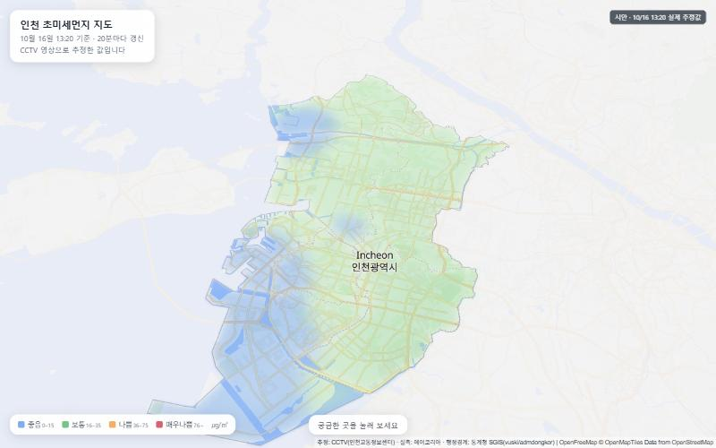

# 인천 초미세먼지 지도

인천 CCTV 20대의 사진으로 AI가 추정한 초미세먼지(PM2.5) 농도를 **인천 지도 위에 구름처럼** 보여 주는 웹 서비스입니다.
누른 곳의 추정 농도와 가까운 측정소 실측값을 알려 주고, 20분마다 갱신합니다.



2026-2 캡스톤디자인 · 교내 전시회 2026-11-11 · 수집기와 AI 모델은 [26_2_AICapstone](https://github.com/lc-moon/26_2_AICapstone)

## 처음 왔다면

1. **[AGENTS.md](AGENTS.md)** — 역할(A 백엔드 / B 프론트), 할 일, API, 규칙. LLM에게 작업을 맡길 때도 이 파일을 먼저 읽힙니다
2. **[CONTRIBUTING.md](CONTRIBUTING.md)** — 브랜치 만들고 PR 올리는 법 (협업이 처음이어도 따라 할 수 있게)
3. **[shared/](shared/)** — 공통 자료와 API 응답 예시. `shared/mockup/index.html`을 더블클릭하면 목표 화면 시안이 열립니다

## 폴더

```
server/   A 백엔드·DB (언어 자유)
web/      B 프론트
shared/   공통 자료 — 직접 고치지 않음
```

## 출처

- 지도: © OpenStreetMap contributors, OpenMapTiles, OpenFreeMap
- 실측: 한국환경공단 에어코리아
- 행정경계: 통계청 SGIS ([vuski/admdongkor](https://github.com/vuski/admdongkor), CC BY 4.0)
- CCTV: 인천교통정보센터
